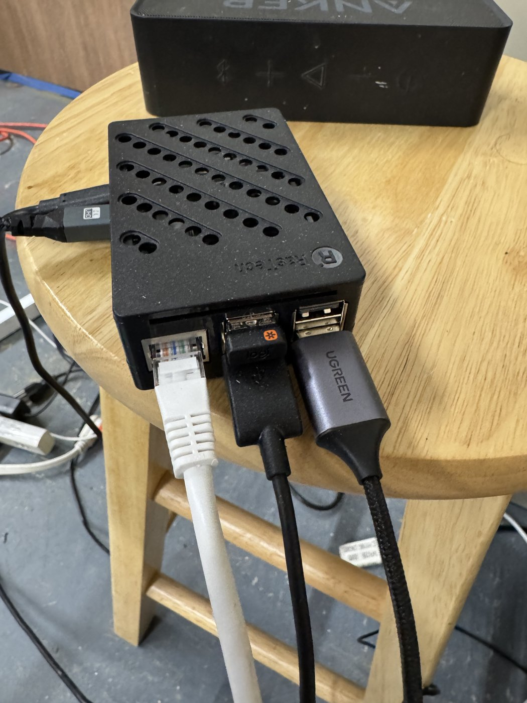
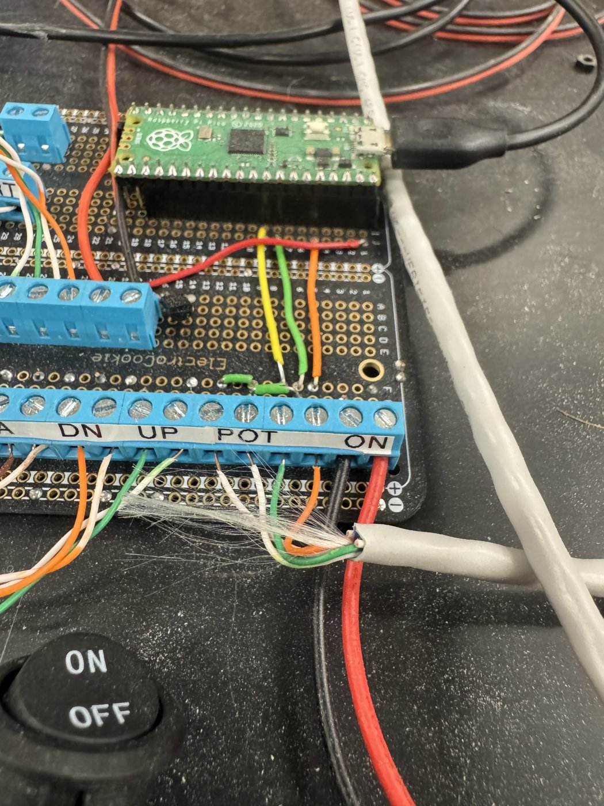
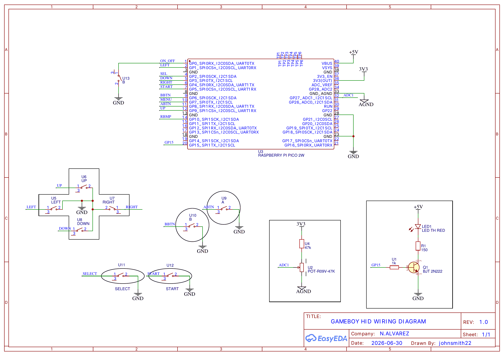

# pi5-colorlight-gameboy

**A Raspberry Pi 5 that talks straight to Colorlight LED receiver cards over Ethernet. No sending card, no HDMI, no X server.**

This is the software behind our 5ft 9in Pokémon Yellow edition giant Game Boy Color, the Raspberry Pi-powered sibling of the green 9ft 7in *World's Largest Game Boy Color*. Both are fully playable and were built by Nick Alvarez and Paige Powell at Inventopia in Davis, California.

```
emulator core ──► colorlight_libretro (Pi 5) ──raw Ethernet──► Colorlight 5A-75B / E80 ──HUB75──► 3×3 LED panels
                         ▲
Pico USB gamepad ────────┘   (giant buttons, power switch, volume knob)
```

## Why this exists

LED video walls normally need two boxes: a **sending card** (such as a Colorlight X2S) that takes HDMI from a computer, and **receiver cards** behind the panels. Most hobby projects either use a sending card or drive HUB75 panels directly from GPIO with a HAT.

This project removes the sending card. The Pi 5 builds the receiver card's Ethernet frames itself and sends them from its gigabit port. The libretro frontend loads an emulator core with `dlopen()`, takes every frame straight from the core's video callback and streams it to the LED wall. There's no screen capture and no intermediate display, just pixels to packets.

**What you get:**

- 192×192 output at the Game Boy's native ~59.7 fps on a 3×3 grid of 64×64 P3 panels
- Real-time pacing: `SCHED_FIFO`, CPU pinning, `mlockall()` and absolute-deadline `clock_nanosleep()`
- Rows sent in 32-row `sendmmsg()` batches, matching the panels' 1/32 scan, plus a short pause before the sync packet that fixes bottom-row flicker
- Works with any libretro core that outputs XRGB8888, RGB565 or 0RGB1555. We run Gambatte with its network link built in, and mGBA works too.
- Battery saves (`.srm`) written every 5 seconds and on power-off, using an atomic write that survives the plug being pulled
- Core options from a `.opt` file or the command line, which is how the Pi joins the link cable for Pokémon trading between the two Game Boys
- A matching **Raspberry Pi Pico / Pico 2** controller: an 11-button USB gamepad, a bistable power switch, an absolute volume knob and a power LED, with a full wiring diagram

## Repository layout

| Path | What it is |
|---|---|
| `driver/colorlight_libretro.c` | The libretro frontend and Colorlight Ethernet driver (single C file) |
| `driver/play.sh` | Picks the next ROM on each power-on and launches the frontend |
| `driver/power_switch.py` | Watches the Pico's power switch: starts the game on ON and saves and stops it on OFF |
| `driver/systemd/gameboy-power.service` | Starts the power switch daemon at boot |
| `driver/install.sh` | Builds and installs everything on the Pi |
| `driver/gambatte/` | Build script, connect-timeout patch and core options for the link-cable Gambatte core |
| `controller/firmware/` | Pico firmware (C, Pico SDK + TinyUSB) |
| `controller/usb_gamepad_pico.uf2` | Prebuilt firmware for the original Pico (RP2040) |
| `controller/usb_gamepad_pico2.uf2` | Prebuilt firmware for the Pico 2 / Pico 2 W (RP2350) |
| `controller/volume_daemon.py` | Turns the volume knob into the Pi's system volume (PipeWire) |
| `docs/colorlight-protocol.md` | Notes on the receiver card packet format |
| `docs/gamepad-wiring-diagram.pdf` | Wiring diagram for the Pico gamepad |

## Hardware

<table>
<tr>
<td width="50%"></td>
<td width="50%"></td>
</tr>
<tr>
<td><b>The whole console.</b> The Raspberry Pi 5 that runs the 5ft 9in Game Boy. The white Ethernet cable goes straight to the Colorlight receiver card behind the LED panels, with no sending card in between. USB connects the Pico controller.</td>
<td><b>The button brain.</b> The Raspberry Pi Pico on a solder-down proto board, with screw terminals for each button (DN, UP…), the volume pot (POT) and the power switch (ON). Twisted-pair cable runs out to the giant buttons in the shell.</td>
</tr>
</table>

| Part | Notes |
|---|---|
| Raspberry Pi 5 | Raspberry Pi OS 64-bit (Bookworm or newer) |
| Colorlight receiver card | E80 or 5A-75B, firmware v13.x |
| 9× 64×64 P3 HUB75 panels, 1/32 scan | 3×3 grid = 192×192 pixels, 576 mm square |
| 5 V supply | Ours is 60 A; nine panels typically draw 18–27 A |
| Ethernet cable | Pi 5 straight to the receiver card's input port, no switch |
| Raspberry Pi Pico, Pico 2 or Pico 2 W | The controller (the wiring diagram shows a Pico 2 W) |
| 10 momentary buttons + 1 latching switch | We use long-arm limit switches behind custom giant buttons |
| 47 kΩ potentiometer + 47 kΩ resistor | Volume knob |
| Red through-hole LED, 150 Ω and 1 kΩ resistors, 2N2222 NPN transistor | Power indicator |
| Audio output and speaker | Anything PipeWire can see |

### Receiver card setup (one time)

Configure the panels on the receiver card once with Colorlight's LEDVision/LEDSetting software on Windows: module type, scan, cabinet size 192×192 and data group order. Save it to the card. For our P3 1/32 panels, setting *Segments* to ×32 gave a 1,920 Hz refresh and removed camera flicker. After that the card remembers everything and the Pi just sends pixels.

### Controller wiring (Pico)

[](docs/gamepad-wiring-diagram.pdf)

*Click for the full PDF ([docs/gamepad-wiring-diagram.pdf](docs/gamepad-wiring-diagram.pdf)). The diagram is the reference for building the controller.*

| GPIO | Function | GPIO | Function |
|---|---|---|---|
| GP0 | Power switch (latching) | GP6 | B |
| GP1 | D-pad left | GP7 | Menu |
| GP2 | Select | GP8 | A |
| GP3 | D-pad down | GP9 | D-pad up |
| GP4 | D-pad right | GP10 | Right bumper |
| GP5 | Start | GP15 | Power LED driver (1 kΩ to the 2N2222 base) |
| GP27 / ADC1 | Volume pot wiper | | |

- **Buttons:** each button connects its GPIO to GND. The Pico's internal pull-ups are used, so no resistors are needed.
- **Volume knob:** a 47 kΩ pot with its ends on AGND and, through a 47 kΩ resistor, 3V3. The wiper goes to ADC1 (GP27). That gives about 0–1.65 V, which the firmware maps to the full volume range.
- **Power LED:** a red through-hole LED and 150 Ω resistor from +5 V (VBUS) to the collector of a 2N2222. The emitter goes to GND and the base goes to GP15 through 1 kΩ. The LED follows the power switch.

## Install

On the Pi 5:

```bash
git clone https://github.com/NicholasJohnAlvarez/pi5-colorlight-gameboy.git
cd pi5-colorlight-gameboy/driver
./install.sh
mkdir -p ~/roms/gbc        # put your own .gb / .gbc files here
```

Flash the controller: hold BOOTSEL on the Pico, plug it in, and copy the matching file onto the drive that appears: `controller/usb_gamepad_pico.uf2` for an original Pico (`RPI-RP2` drive), or `controller/usb_gamepad_pico2.uf2` for a Pico 2 / Pico 2 W (`RP2350` drive). To build it yourself, see `controller/firmware/` (standard Pico SDK CMake build with `-DPICO_BOARD=pico` or `-DPICO_BOARD=pico2`).

Volume knob service (runs as your user):

```bash
mkdir -p ~/.config/systemd/user
cp ../controller/systemd/volume-daemon.service ~/.config/systemd/user/
systemctl --user daemon-reload && systemctl --user enable --now volume-daemon
```

If the game sounds quieter than other apps, run `amixer sset PCM 100%` once.

Now flip the power switch. Each power-on loads the next game in `~/roms/gbc`. Hold **Menu** while switching on to lock the current game (and again to unlock).

## Running by hand

```bash
./colorlight_libretro -i eth0 \
    -c /usr/lib/aarch64-linux-gnu/libretro/mgba_libretro.so \
    -r ~/roms/gbc/game.gbc -b 80
```

Useful options:

| Option | Default | |
|---|---|---|
| `-i` | `eth0` | Interface wired to the receiver card |
| `-W` / `-H` | 192 / 192 | Output size (match your cabinet) |
| `--integer` | off | 1:1 pixels instead of aspect-fit (160×144 → 192×172) |
| `-y` / `-x` | 0 | Nudge the image to line up with the bezel |
| `-b` | 255 | Receiver card brightness; we run at 80 |
| `-d`, `--dim` | 1.0 | Software brightness, if your card ignores `-b` |
| `--batch` | 32 | Rows per `sendmmsg()` call |
| `--sync-delay` | 500 µs | Raise it if the last rows flicker |
| `--cpu` | 3 | CPU core to pin to (`-1` disables) |
| `--opt KEY=VALUE` | | Core option, repeatable (overrides the file) |
| `--opts-file PATH` | | Load core options from a RetroArch-style `.opt` file |
| `--log-vars` | off | Print every option the core asks for |
| `--pot-volume` | off | Scale game audio by the knob directly instead of using `volume_daemon.py` |

### Pokémon trading between two Game Boys

The two giant Game Boys trade Pokémon over Wi-Fi through a real emulated link cable. We tested it by sending a Kadabra from Pokémon Red on the 9ft 7in and having it arrive as an Alakazam in Pokémon Yellow on this Pi.

How it works:

- **Gambatte's network link, not netplay.** RetroArch netplay syncs two copies of the *same* game, which is useless for trading. Gambatte's "netlink" tunnels the raw bytes the games send over the link port through a TCP socket. One side is the server, the other the client.
- **It must be built in.** Prebuilt Gambatte cores have `HAVE_NETWORK=0`. `driver/gambatte/build_gambatte.sh` builds it with the link enabled (commit `d9d6cd0`), applies our patch and installs it to `driver/cores/`. `play.sh` uses it automatically when it's there.
- **No settings change between trading days and normal days.** Stock Gambatte uses a blocking `connect()`, so a client with no server waits about 2 minutes before the game appears. `patch_connect_timeout.py` limits that to 1 second. When the Pi powers on, it links if the other Game Boy is up and otherwise just plays.
- **Core options from a file.** This frontend has no menu, so `--opts-file driver/gambatte/gambatte.opt` answers the core's option requests: GBC mode, boot logo, link mode, port, and the server IP as twelve zero-padded digits (192.168.1.20 → `1 9 2 1 6 8 0 0 1 0 2 0`). `--log-vars` prints every option the core asks for.

Setup checklist:

1. On the Pi: `./gambatte/build_gambatte.sh`, then put the server's Wi-Fi IP in `gambatte/gambatte.opt`.
2. Put `gbc_bios.bin` (2,304 bytes, your own dump) in the ROM folder for the boot logo.
3. Use Wi-Fi for the link. The Pi's Ethernet port is wired to the receiver card and has no route to the network. Turn off Wi-Fi power saving with `sudo iw dev wlan0 set power_save off`, because the doze adds latency spikes that break the Cable Club handshake.
4. On the server (our 9ft 7in runs RetroArch on Windows): use the same Gambatte commit built with the network link. Set link mode to **Network Server** and **all twelve IP digits to 0**, because in server mode they are the *bind* address. On Windows, also set `network_cmd_enable = "true"` in `retroarch.cfg`. Gambatte never calls `WSAStartup()`, and this makes RetroArch do it; otherwise you get "Error opening socket: No error". Allow TCP 56400 through the firewall.
5. Start the server Game Boy first, then power on the Pi. Count down together before both players talk to the Cable Club attendant, because the handshake window is short.

## Notes and limitations

- The Game Boy Color screen is 160×144. HUB75 panels come in 32×32 and 64×64 blocks, so we used a 192×192 grid and scale the image to fit. It's close, but not pixel-perfect.
- Brightness: if the receiver card has brightness saved in flash, it may ignore `-b`. Use `--dim` instead.
- If the link partner stops in the middle of a trade, the emulator can freeze, because Gambatte still uses a blocking read. Restart both Game Boys.
- Bring your own legally owned ROMs or homebrew. No games or BIOS files are included.
- The green 9ft 7in World's Largest Game Boy Color uses a Windows mini PC and a Colorlight X2S sending card instead. It uses the same Pico controller.

## Credits

- Built by **Nick Alvarez** (electronics, firmware, software) and **Paige Powell** (CAD, fabrication, art), with sound design by **Fabrizio D'Amelio**, button mechanisms by UC Davis volunteers, and the support of **Tim Keller** and Inventopia, Davis CA.
- The Colorlight packet format comes from the community's reverse-engineering of the 5A-75B/E80 receiver cards. Thanks to everyone who documented it.
- [libretro](https://www.libretro.com/), [mGBA](https://mgba.io/), [Gambatte](https://github.com/libretro/gambatte-libretro), [Raspberry Pi Pico SDK](https://github.com/raspberrypi/pico-sdk) and [TinyUSB](https://github.com/hathach/tinyusb).
- Follow the builds: Instagram [@NickBuildStuff](https://instagram.com/NickBuildStuff) and [@ppow_creative](https://instagram.com/ppow_creative).

## License

MIT. See [LICENSE](LICENSE). Emulator cores are separate projects with their own licences; this frontend only loads them at runtime.
